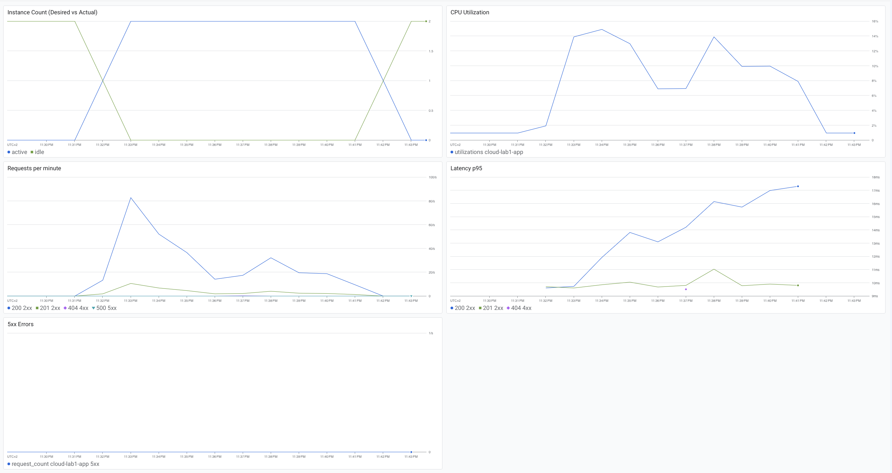

# Автоматичне масштабування та Панель моніторингу (Завдання 1, 3)

## Завдання 1. Автоматичне масштабування

Я налаштував політику масштабування в Terraform у файлі main.tf. Вказав мінімум 1 екземпляр (вдень 2 для надійності) і максимум 4. 

Чому саме 4 екземпляри? Це вимога лабораторної роботи (не більше 4). Крім того, навіть якщо навантаження буде дуже великим, це не призведе до величезних витрат.

Період стабілізації (cooldown) - це час, який система чекає перед тим, як створити новий екземпляр або видалити старий. Якщо встановити його рівним нулю, система буде реагувати на найменший стрибок навантаження. Це погано, бо екземпляри будуть постійно створюватися і видалятися (це називається flapping), що створить зайве навантаження на хмару і збільшить витрати.

## Завдання 3. Панель моніторингу

Для візуалізації роботи сервісу я створив панель моніторингу (Dashboard) у сервісі Google Cloud Monitoring. Ця панель також описана в коді Terraform у файлі monitoring.tf.

На панелі налаштовано п'ять основних графіків:
1. Кількість екземплярів (Instance Count).
2. Завантаження процесора (CPU Utilization).
3. Кількість запитів за хвилину (Requests per minute).
4. Латентність (Latency p95).
5. Кількість помилок сервера (5xx Errors).

Аналіз графіків під час тесту:
- На графіку "Requests per minute" чітко видно початок навантаження, коли кількість запитів різко зросла.
- На графіку "CPU Utilization" видно, як зросло навантаження на процесор (приблизно до 16%).
- На графіку "Instance Count" видно, як екземпляри почали працювати (active).
- На графіку "Latency p95" видно, як змінився час відповіді.
- Графік "5xx Errors" залишився порожнім, що свідчить про те, що сервер не падав.

### Чому є затримка між перетином порогу і появою екземпляра?
Коли навантаження зростає, Cloud Run не створює новий екземпляр миттєво. Є дві причини:
1. Період стабілізації: система чекає кілька секунд, щоб переконатися, що навантаження дійсно зросло, а не є короткочасним сплеском.
2. Час запуску (Cold Start): після ухвалення рішення Google має виділити сервер, завантажити туди Docker-образ і запустити Node.js. Це займає додатковий час.

### Чому вилучення екземплярів відбувається пізніше за падіння навантаження?
Коли навантаження падає, Cloud Run не вимикає екземпляри одразу. Він чекає певний час (cooldown), щоб уникнути ситуації, коли навантаження знову різко зросте.